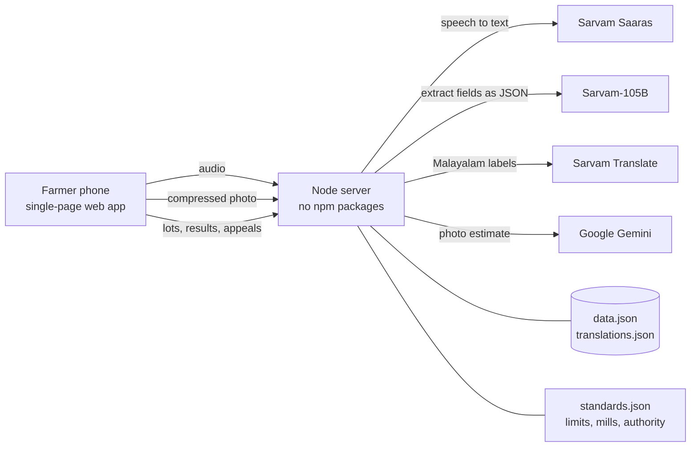

# Paddy Lot Tracker: a farmer's evidence file for the mill gate

> A farmer-only web app for Kuttanad, Kainakary and Champakulam. It turns "the mill told me to add 2 kg per 100 kg" into a timed, recorded, checkable case.

---

## 1. The story behind it
 
*This is an illustrative composite based on how paddy handling in Kuttanad is described by farmers. It is not a record of one named person.*
 
It is harvest season in Kainakary. A combine harvester cuts the field in one pass and the paddy comes off as a mass. The farmer stores it, in a heap or in sacks, and waits for the mill's quality team. The rule is that their people come, collect a sample and test its moisture and quality within a set time.
 
They do not come properly. The first day passes, then the second. The paddy is still sitting there, and every hour of waiting is the farmer's risk, because nobody has recorded when the harvest was done or when the team was due.
 
When the sample is finally taken and tested, the result is bad: moisture over the limit, "too much chaff". The mill says: *add 2 kg to every 100 kg, or we reject the lot.*
 
She has no way to answer.
 
- She has **no record** of when the harvest was done or when the quality team was due.
- She cannot show that the **mill's own team was late** and that the paddy kept waiting while the moisture changed.
- She has **no independent estimate** of the chaff in her own paddy.
- She does not know if "2 kg per 100 kg" is fair for a **0.4-point excess** or a 3-point one.
- She has **never had a way to appeal**. Forced to accept, she accepted.
This app gives her that file, in her own language, from her own phone.
 
---
## 2. What the app does

| # | Feature | What the farmer gets |
|---|---|---|
| 1 | **Harvest log** with Malayalam voice input | Says name, plot, quintals, mill and harvest time. The form fills itself. No typing in the field. |
| 2 | **Lot tracker** | Live countdown to the 72 h moisture check, 96 h hard limit. Lots grouped as Overdue, Waiting and Inspected with counts. |
| 3 | **Report delay / Report mill** | Stamps the time of the delay and opens a pre-written complaint email to the authority. |
| 4 | **Mill result entry** | One field per FAQ parameter plus inspection time. Each parameter shows Within limit or Over limit. Moisture over 17% gets a prominent warning with hours since harvest. |
| 5 | **Photo check** | Photo of a sample gives a rough range for chaff, discoloured and damaged grain, with confidence. |
| 6 | **Fair sampling guide** | Five-step guide and a declaration tick so the sample is random, not hand-picked. |
| 7 | **Fair deduction calculator** | Works out what a proportional deduction is, so tiny excesses are not punished. Compares it with what the mill asked. |
| 8 | **Appeal and re-test** | If the mill's figure is far above the photo estimate, or the deduction is above the fair amount, the farmer can raise an appeal. If moisture is high, they can ask for a re-check after drying. |
| 9 | **Evidence page** | One printable page per lot: timeline, deadlines, delay hours, mill values, fair deduction, photo estimate, flags, appeal and re-test, plus the source of the limits. |
| 10 | **Malayalam / English** | English by default, one tap to Malayalam labels through Sarvam Translate. |

Eight demo lots are seeded across Kuttanad, Kainakary and Champakulam, covering every state: waiting, overdue, past the hard limit, inspected on time, and inspected late with high moisture.

---

## 3. The design principle: make the system fair, not hostile

The app is built so that it **cannot be accused of favouring the farmer**.

- **Estimates are labelled rough.** The photo check says on screen that it cannot measure moisture and cannot judge differences of 1 to 2 points.
- **Flagging is conservative.** A parameter is flagged only when the mill's value is more than **3 points above the model's high estimate**, and **never when confidence is low**. Foreign matter is compared as organic plus inorganic combined.
- **A flag means "ask for a re-test", not "the mill cheated".** The appeal email says the photo estimate is a reason to re-test, not proof.
- **Sampling is declared.** The farmer must tick that handfuls were mixed from the edge and centre of the field before the photo upload unlocks. The declaration is stored on the evidence page.
- **Limits live in a config file** (`standards.json`) with the source name printed on the evidence page. Nothing is hard-coded.

### Fair deduction: the maths

The calculator gives a proportional guide and compares it with the mill's demand.

- **Grace:** only the excess above the limit **plus 0.5 points** is counted, because mill tests have small errors. Tiny excesses cost nothing, and the deduction grows smoothly with no cliff.
- **Moisture:** extra water is counted by weight, so the deduction in kg per 100 kg is `(moisture − 17) ÷ (100 − 17) × 100`, applied to the part beyond the grace.
- **Other parameters:** each point over the limit, after the grace, counts as about 1 kg per 100 kg.

| Case | Fair deduction |
|---|---|
| 17.4% moisture, 1.3% organic foreign matter (both inside the grace) | **0 kg per 100 kg** |
| 19.4% moisture, 1.8% organic foreign matter | **about 2.59 kg per 100 kg** (2.29 moisture and 0.30 foreign matter) |

If the mill asks for more than the fair total plus 0.5 kg, the app flags it and offers an appeal asking for an itemised calculation and a re-test.

> This is a proportional guide built from the limits, not an official procurement rule. The grace and tolerance are set in `standards.json` (`grace_points`, `demand_tolerance_kg`) so they can be matched to the real rules.

---

## 4. Architecture



- **Frontend:** one HTML file, plain JavaScript, no framework and no build step.
- **Backend:** one Node.js file using only built-in modules and native `fetch`. Runs on Node 18 or later.
- **Secrets:** API keys are read from server environment variables and never reach the browser.
- **Storage:** a JSON file, so there is nothing to install or migrate.

### AI services and why each one is used

| Service | Job | Why |
|---|---|---|
| Sarvam **Saaras** | Malayalam speech to text | Built for Indian languages, handles the farmer's own speech. |
| Sarvam **Sarvam-105B** | Turns the transcript into form fields | The server gives it the allowed mills and the current IST time. It returns only the day offset, hour and minute, and the server builds the exact timestamp, which avoids date mistakes. |
| Sarvam **Translate** | Malayalam interface labels | Translations are cached, so each label is translated once. |
| Google **Gemini** (`gemini-3-flash-preview` by default, changeable with `GEMINI_MODEL`) | Photo estimate of chaff, discoloured and damaged grain | A free-tier vision model, called with the official REST API. The prompt asks for ranges, tells the model to be conservative, and sets confidence to low for bad photos. |

---

## 5. Run it

Requires Node.js 18 or later. There is nothing to `npm install`.

```bash
SARVAM_API_KEY=... GEMINI_API_KEY=... node server.js
```

Open `http://localhost:3000`.

Folder layout (keep `index.html` inside `public/`):

```
paddy-app/
  server.js          backend, API routes, AI calls
  standards.json     limits, mills, authority, grace settings
  public/
    index.html       the whole frontend
  data.json          created on first run (lots)
  translations.json  created on first run (Malayalam cache)
```

Optional environment variables: `PORT`, `GEMINI_MODEL`, `SARVAM_STT_MODEL`, `SARVAM_LLM`.

### Configure before a real pilot

Edit `standards.json`:

- `source`: the exact citation printed on the evidence page.
- `mills`: the real list of approved mills. **The five names in the repo are placeholders.**
- `authority.email`: where complaint and appeal emails should go.
- `grace_points` and `demand_tolerance_kg`: tune the fair deduction.

---

## 6. Demo script (about three minutes)

1. **List view.** Show the Overdue, Waiting and Inspected sections with counts and the live countdowns.
2. **Voice.** Open *New harvest log*, tap the mic and say the example sentence:
   *എന്റെ പേര് രാജേഷ്. പ്ലോട്ട് നമ്പർ ഏഴ്. ഇരുപത്തിയഞ്ച് ക്വിന്റൽ. കുട്ടനാട് മിൽ ഒന്ന്. നാളെ രാവിലെ പത്ത് മണി.*
   The name, plot, quintals, mill dropdown and time fill in. (Saying "yesterday" instead of "tomorrow" gives a past harvest time.)
3. **Overdue lot.** Open an overdue lot, show the delay hours, tap **Report mill to authority** and show the pre-filled email.
4. **High-moisture lot.** Open the lot with 19.4% moisture. Show the warning with hours since harvest and the **Fair deduction** table. Enter a mill demand of 5 kg and show the flag against the fair 2.59 kg.
5. **Photo check.** Tick the sampling declaration, upload a paddy photo and show the ranges, confidence and the rough-estimate warning.
6. **Appeal and re-test.** Raise an appeal and request a re-check after drying.
7. **Evidence page.** Open it and print. Switch to Malayalam to finish.

---

## 7. API reference

| Method and path | Purpose |
|---|---|
| `GET /api/config` | Limits, labels, mills, authority, source name |
| `GET /api/lots` | All lots |
| `POST /api/lots` | Create a lot |
| `POST /api/lots/:id/delay` | Stamp the delay report |
| `POST /api/lots/:id/report` | Stamp the report to the authority |
| `POST /api/lots/:id/result` | Save the mill result (closes the countdown) |
| `POST /api/lots/:id/demand` | Save the extra kg per 100 kg the mill asked |
| `POST /api/lots/:id/appeal` | Raise an appeal (also opens a re-test) |
| `POST /api/lots/:id/retest` | Request a re-check, for example after drying |
| `POST /api/lots/:id/retestresult` | Save the re-test result |
| `POST /api/voice` | Audio to transcript to form fields |
| `POST /api/photo` | Photo to chaff, discoloured and damaged estimates |
| `POST /api/translate` | English labels to Malayalam |

Error handling covers an invalid Gemini key (401), quota limits (429), malformed model JSON (502), bad or empty images (400 and 415), a missing `public/index.html`, and a missing key on the server.

---

## 8. Verification status and known limits

**Checked locally:**
- Syntax and the full set of server routes.
- The Gemini photo route against a stand-in server: a good response, invalid key, quota error, malformed JSON, missing key, empty image and wrong file type.
- The voice extraction against a stand-in Sarvam server, including the mill dropdown match and the day and hour to timestamp conversion.
- That each screen renders, including the sections, the fair deduction block and the appeal flow.

**Run once with your own keys before presenting:**
- A real Gemini call with a real paddy photo, to confirm the model name is still available and returns valid JSON.
- A real Malayalam recording through Saaras and Sarvam-105B.
- The Malayalam toggle through Sarvam Translate.

**Honest limits:**
- A photo cannot measure moisture, and a visual estimate cannot judge differences of 1 to 2 points. The app says so wherever it shows an estimate.
- The photo estimate is only as fair as the sample. That is why the sampling guide and declaration exist.
- The fair deduction is a proportional guide, not a legal rule.
- The app cannot send email itself. It opens the farmer's mail app with the message ready, and logs the time.
- Data is stored in a single JSON file. That is fine for a pilot, not for scale.
- The mill names, authority email and source citation are placeholders to confirm.

---

## 9. Roadmap

1. Verify the limits and deduction rules with a procurement officer and agree the grace values.
2. Send reports and appeals through WhatsApp or SMS as well as email.
3. Photo hashing and timestamps on samples, to strengthen the evidence.
4. A tamper-evident log so the authority can trust the timeline.
5. Aggregate view for the authority: which mills are repeatedly late, by area and week.
6. Offline mode for poor signal in the paddy fields.
7. More languages, using the same translation route.

---

## 10. Why this fits the problem

| Judging question | Answer |
|---|---|
| Is the problem real? | Delayed checks and unexplained deductions affect farmers who have no record and no route to appeal. |
| Is AI used for something it is good at? | Voice in Malayalam, structured extraction, translation and visual screening. Never as the final judge. |
| Is it responsible? | Conservative thresholds, a confidence gate, rough-estimate labels, a sampling declaration, and every flag leading to a re-test. |
| Can it run in the field? | One Node file, one HTML file, no dependencies, built for a phone. |
| Is it inclusive? | Malayalam voice input and Malayalam labels. |
| Can it grow? | Limits, mills and authority are configuration, so another district or crop is a config change. |
